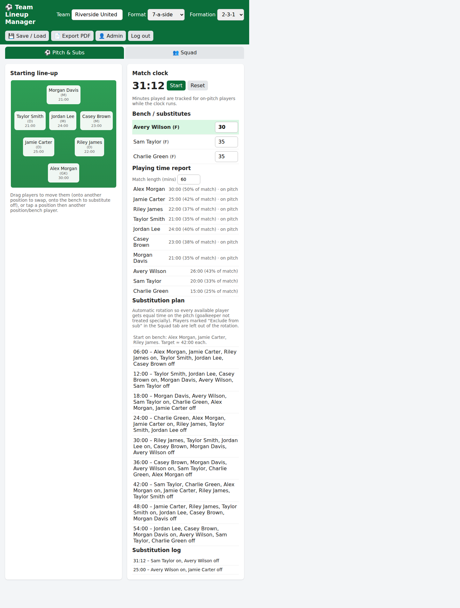
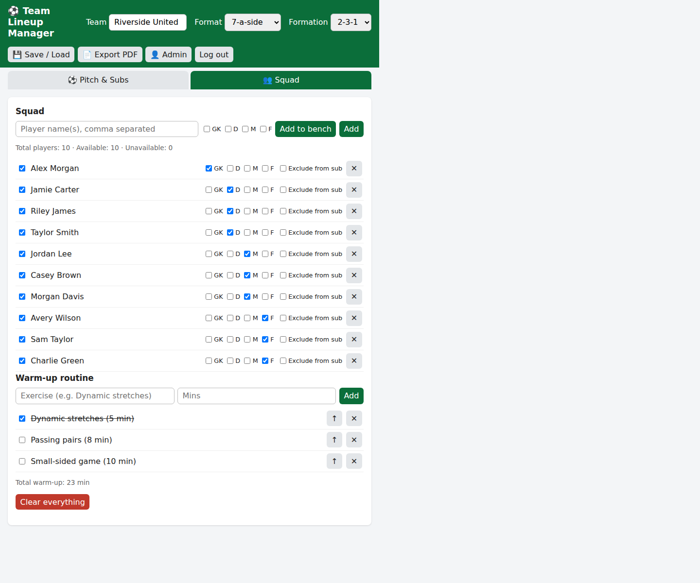

# FootballLineup

A lightweight, browser-based tool for planning football team line-ups and managing match-day substitutions. The UI is a single HTML file (index.html). Accounts and cloud sync use Convex; the client is bundled into cloud-auth.js with 
pm run build (only needed after editing src/).

## Screenshots

### Pitch and match management



### Squad and warm-up



Screenshots use fictional sample players and team data.

## Getting started

1. Clone or download this repository.
2. Serve the repository over `localhost` or HTTPS. For example:

   ```sh
   python3 -m http.server 8000
   ```

3. Open `http://localhost:8000` in your browser.
4. Create an account with your email and a password of at least eight characters.

## Using the app

- **Set up a squad:** Add one or more players, mark their preferred positions, and set player availability in the **Squad** tab.
- **Arrange a line-up:** Choose a team format and formation. Drag players between pitch positions or the bench, or select a player and then a destination to swap them.
- **Manage a match:** Start the match clock to track playing time. Enter the match length to see a playing-time report and an automatic, equal-time substitution plan. Set an individual bench player's planned entry time if needed.
- **Plan a warm-up:** Add timed exercises, mark them complete, and reorder the routine.
- **Track match events:** Tap ⚽ under a player to log a goal (with an Undo toast), or ⋯ for labelled Goal / Assist / Amazing play / Great save buttons. Log opposition goals, see the score and a match timeline strip, and use **Undo** or delete timeline entries to correct mistakes. A bar on each player shows minutes played.
- **Match bar and tools:** The score, clock, big Start/Pause button and a "Next sub in" countdown stay pinned at the top. Sub plan, playing time, timeline, sharing, finish and reset live in **Match tools**. Pick a team colour in **Team settings** (⚙︎) to theme the app and share cards.
- **Periods and alerts:** Choose halves, thirds or quarters and end each period from the clock card (the clock pauses). In Match tools, **Team for each period** lets you save a different team for each quarter; it goes on the pitch automatically when that period starts. Planned subs show a one-tap **Make sub** card, and the app vibrates and beeps when a sub is due. The screen stays awake while the clock runs where the browser supports it. show a one-tap **Make sub** card, and the app vibrates and beeps when a sub is due. The screen stays awake while the clock runs where the browser supports it.
- **Season stats:** **Finish match & save to season** stores the result and each player's minutes and events; the **Season** tab totals them.
- **Share:** Share a result card, a line-up image, line-up text or a match summary using the device share sheet (falls back to saving or copying).
- **Install:** Host the files over HTTPS and use *Add to Home Screen* to install the app and use it offline.
- **Save and share:** Save line-ups in the browser, optionally set a default line-up, and import or export saved plans as JSON. Export the current or a saved line-up as a PDF.
- **Accounts and sync:** Your team, players and match history are saved to your account and restored when you sign in on any device. Log out and **Delete my account** (which erases your cloud data) are in settings.

## Data and privacy

Data is kept in the browser's local storage and synced to your Convex-hosted account (email and password sign-in). Logging out clears local data from the device. Deleting your account removes your cloud data.
